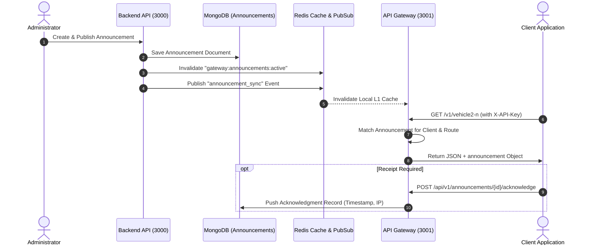

# KARVION API MANAGER — DYNAMIC ANNOUNCEMENT MANAGEMENT SYSTEM

**Platform Domain:** `https://api.karviontechnologies.in`  
**Classification:** Core System Specification  
**Component:** Gateway Response Injection & Announcement Lifecycle  

---

## 1. OVERVIEW

The Dynamic Announcement System enables the administrator to publish notices that are injected directly into live API responses received by client applications without breaking existing JSON data contracts.

### Real-Time Propagation Pipeline:


---

## 2. ANNOUNCEMENT TARGETING CAPABILITIES

| Target Scope | Description | Evaluation Rule |
|---|---|---|
| `global` | All APIs and all clients | Matches every authenticated request |
| `api` | Specific API catalog item | Matches `targetApiId == route.id` or `route.slug` |
| `endpoint` | Specific endpoint route | Matches `req.path.startsWith(targetEndpoint)` |
| `client` | Specific customer account | Matches `targetClientId == customer.customerId` |
| `apiKey` | Specific API key | Matches `targetApiKey == customer.keyPrefix` |
| `version` | Specific API version | Matches `targetVersion == route.version` |

---

## 3. RESPONSE INJECTION SCHEMA

When an announcement is active, the Gateway injects the announcement object at the root of the JSON response:

```json
{
  "success": true,
  "developer": "arjunkahar",
  "req_left": 4982,
  "req_total": 5000,
  "expiry": "31-12-2099",
  "announcement": {
    "id": "ANN-1001",
    "active": true,
    "type": "maintenance",
    "severity": "warning",
    "title": "Scheduled Upstream Maintenance",
    "message": "Vehicle OSINT will undergo maintenance at 10 PM. No downtime expected.",
    "action_url": "https://api.karviontechnologies.in/status",
    "recommended_action": "Set client HTTP timeouts to 30s during maintenance window",
    "published_at": "2026-11-21T10:00:00Z",
    "acknowledgment_required": true
  },
  "data": {
    "rc_number": "DL01AB1234",
    "status": "ACTIVE"
  }
}
```

### HTTP Headers Injected:
- `X-Karvion-Announcement`: ID of the active announcement (`ANN-1001`).
- `X-Karvion-Ack-Required`: `true` if receipt is required.
- `X-Karvion-Ack-Url`: `/api/v1/announcements/ANN-1001/acknowledge`.

---

## 4. CLIENT ACKNOWLEDGMENT ENDPOINT

Clients can acknowledge receipts via:
- **HTTP Method:** `POST`
- **Path:** `/api/v1/announcements/:id/acknowledge`
- **Header:** `X-API-Key: arjun_live_...` or `Authorization: Bearer arjun_live_...`

**Success Response:**
```json
{
  "success": true,
  "status": "acknowledged",
  "message": "Announcement ANN-1001 acknowledged successfully.",
  "data": {
    "announcement_id": "ANN-1001",
    "client_id": "6b016fbaa5a151b0f96e8fb9",
    "acknowledged_at": "2026-11-21T10:15:30.000Z"
  }
}
```
