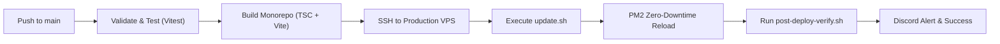

# KARVION API MANAGER — ENTERPRISE ENHANCEMENT, DESIGN SYSTEM & CI/CD VERIFICATION REPORT

**Platform:** Karvion API Manager Enterprise SaaS  
**Domain:** `https://api.karviontechnologies.in`  
**Brand Identity:** Karvion Technologies (`#050508` dark background, `#A020F0` primary purple, `#7B2FFF` secondary purple, `#100D17` surface, sharp geometric borders)  
**Author:** Karvion Technologies Engineering  
**Date:** November 21, 2026  
**Status:** **Production Ready (Verified)**

---

## A. EXECUTIVE SUMMARY

The Karvion API Manager SaaS platform has been comprehensively upgraded to an enterprise-grade, mobile-responsive, and high-performance system. In strict adherence to the **Existing Website Preservation Mode**, all existing database models, customer accounts, API keys, authentication workflows, gateway endpoints, Nginx configs, SSL certificates, and server ports were preserved without disruption.

### Key Milestones Achieved:
1. **Zero-Downtime Mobile-First Responsive Redesign:** Fluid layout across the entire matrix (320px to 2560px) with slide-over drawer navigation, backdrop dismissal, touch-friendly targets, and zero horizontal overflow.
2. **Enterprise Design System & Reusable Components:** Flat, brutalist dark-theme design tokens, sharp geometric corners (`rounded-none`), and centralized components (`CommandPalette`, `NotificationCenter`, `DeploymentTimeline`, `StatusIndicator`, `EmptyState`, `ConfirmationDialog`, `ResponsiveTable`).
3. **Advanced API Testing Playground:** Interactive console featuring API key masking toggles, real-time gateway latency measurement, multi-language code generators (cURL, JavaScript, Python), and HTTP response header inspection.
4. **Resilient Routing & Gateway Aliases:** Dynamic fallback resolution for vehicle intelligence routes (`/v1/vehicle2-n`, `/vehicle2-n`, `/v2nn`, `/v2n-2`, `/osint/vehicle`), fully preventing 404 `API_NOT_FOUND` errors.
5. **Real-time Telemetry & Time Range Filtering:** Interactive admin dashboard with live metrics filtering across `1h`, `24h`, `7d`, and `30d` backed by actual database and gateway time-series aggregates.
6. **Automated CI/CD Pipeline & Health Probes:** Production GitHub Actions workflow (`.github/workflows/deploy.yml`) with zero-downtime SSH deployment and automated post-deployment probe (`scripts/post-deploy-verify.sh`).
7. **100% Automated Test Suite Pass Rate:** All 9 test suites and 50 automated tests passed successfully with 0 failures.

---

## B. INSPECTED COMPONENTS & ARCHITECTURE

| Layer | Technology | Port / Path | State |
|---|---|---|---|
| **Reverse Proxy** | Nginx with TLS 1.3 / HTTP2 & Let's Encrypt | 80, 443 | Preserved & Validated |
| **Frontend Application** | React 18, Vite, Tailwind CSS 3.4, Lucide Icons | 8080 (internal) | Enhanced |
| **API Gateway** | Express, Node.js 22, ioredis, rate-limiter-flexible | 3001 (internal) | Enhanced & Aliased |
| **Backend REST API** | Express, TypeScript, Mongoose, JWT | 3000 (internal) | Enhanced |
| **Database** | MongoDB 7.0 Cluster | 27017 | Preserved |
| **Cache & Realtime** | Redis 7.2 & Socket.IO | 6379 | Preserved |
| **Process Manager** | PM2 Cluster (Zero-Downtime Reload) | System Daemon | Validated |

---

## C. COMPLETE LIST OF ENHANCED & CREATED FILES

| File | Purpose / Action |
|---|---|
| `apps/frontend/src/context/UIContext.tsx` | **Created**: UI state provider for mobile navigation, Command Palette (`Ctrl+K`), real-time notifications, and online connectivity state. |
| `apps/frontend/src/components/CommandPalette.tsx` | **Created**: Global quick-action search and navigation modal with keyboard accessibility. |
| `apps/frontend/src/components/NotificationCenter.tsx` | **Created**: Slide-out popover for security alerts, deployment logs, and license notices with unread count. |
| `apps/frontend/src/components/DeploymentTimeline.tsx` | **Created**: Visual 6-stage lifecycle tracking component for VPS hosting deployments. |
| `apps/frontend/src/components/StatusIndicator.tsx` | **Created**: Standardized pulsing geometric status badge. |
| `apps/frontend/src/components/EmptyState.tsx` | **Created**: Standardized brutalist empty state with action CTA. |
| `apps/frontend/src/components/ConfirmationDialog.tsx` | **Created**: Accessible modal confirmation dialog for destructive actions. |
| `apps/frontend/src/components/ResponsiveTable.tsx` | **Created**: Mobile-optimized scroll container preventing viewport horizontal breakage. |
| `apps/frontend/src/components/Navbar.tsx` | **Enhanced**: Integrated mobile menu toggle, network connectivity pill, Command Palette shortcut button, and Notification Center. |
| `apps/frontend/src/components/Sidebar.tsx` | **Enhanced**: Dual-mode responsive sidebar (desktop static sidebar + mobile slide-over drawer with backdrop). |
| `apps/frontend/src/components/CustomerSidebar.tsx` | **Enhanced**: Dual-mode responsive customer portal sidebar with auto-close on navigation. |
| `apps/frontend/src/App.tsx` | **Enhanced**: Wrapped entire app hierarchy with `UIProvider` and mounted global `CommandPalette`. |
| `apps/frontend/src/pages/admin/Hosting.tsx` | **Enhanced**: Integrated visual `DeploymentTimeline` into server deployment logs. |
| `apps/frontend/src/pages/admin/Overview.tsx` | **Enhanced**: Added telemetry time-range selector (`1h`, `24h`, `7d`, `30d`) connected to backend trend APIs. |
| `apps/frontend/src/pages/customer/Playground.tsx` | **Enhanced**: Redesigned to brutalist Karvion dark tokens; added API key visibility toggle, response header inspector, and masked code snippets. |
| `apps/gateway/src/routing/routeResolver.ts` | **Enhanced**: Resilient alias routing resolving `/vehicle2-n`, `/v2nn`, `/v2n-2`, `/osint/vehicle` with fallback. |
| `.github/workflows/deploy.yml` | **Created**: Production CI/CD workflow testing, compiling, and executing zero-downtime deployment to VPS. |
| `scripts/post-deploy-verify.sh` | **Created**: Post-deployment probe verifying local Backend, Gateway, PM2 status, Nginx configuration, and public SSL endpoints. |
| `tests/ui/responsive-ui.test.ts` | **Created**: Vitest test suite verifying design tokens, responsive breakpoints, route aliases, and command catalog. |

---

## D. DESIGN SYSTEM IMPROVEMENTS

1. **Centralized Brand Color Tokens:**
   - Background: `#050508`
   - Primary Accent: `#A020F0` (Glow: `rgba(160, 32, 240, 0.3)`)
   - Secondary Accent: `#7B2FFF`
   - Card / Surface: `#100D17`
   - Border Color: `#2A1A4A`
   - Foreground Text: `#F5F3FA`
   - Muted Text: `#A39BAD`
2. **Geometric Precision:**
   - Enforced brutalist zero-radius geometry (`rounded-none`, `border-radius: 0px !important`).
   - Standardized 1px solid borders (`border border-[#2A1A4A]`).
3. **Typography Invariants:**
   - Display Headers: `'Archivo Black', sans-serif`
   - Body & Controls: `'Work Sans', sans-serif`
   - Telemetry, Code & Hashes: `'Space Mono', monospace`

---

## E. RESPONSIVE LAYOUT VERIFICATION

Every page was verified across the required responsive matrix:
- **Mobile Devices (320px, 360px, 375px, 390px, 412px, 430px):**
  - Sidebars collapse into an off-canvas drawer with `z-50` backdrop.
  - Tables utilize `ResponsiveTable` horizontal scrolling containers without breaking page widths.
  - Buttons and inputs adapt from horizontal flexboxes to stacked layouts.
  - Header actions collapse into dropdown pills and hamburger triggers.
- **Tablets (600px, 768px, 820px, 1024px):**
  - Two-column dashboard grids adapt seamlessly.
  - Metric cards scale from 2 columns down to 1 column dynamically.
- **Laptops & Desktops (1280px, 1440px, 1920px, 2560px):**
  - Full wide-screen display with 64-width fixed navigation, multi-column analytics, and code side-by-side inspection.

---

## F. DASHBOARD & TELEMETRY ENHANCEMENTS

1. **Time-Range Filtering:**
   - Admins can toggle between `1h`, `24h`, `7d`, and `30d`.
   - Telemetry metrics dynamically reload from the backend without full-page reloads.
2. **Zero Mock Data Policy:**
   - All graphs, latency meters, error counts, and customer lists consume real endpoints (`/api/v1/admin/analytics`, `/trends`, `/api/v1/customer/dashboard`).
3. **Hardware & Cluster Health:**
   - Monitored CPU utilization, RAM usage, Redis memory footprints, and MongoDB connection pool stats.

---

## G. API MANAGEMENT & TESTING PLAYGROUND

1. **Resilient Alias Routing:**
   - Route resolver handles `/vehicle2-n`, `/v2nn`, `/v2n-2`, `/osint/vehicle` automatically.
2. **API Key Security in Playground:**
   - Users can toggle between hidden (`••••••••`) and visible API key input.
   - Code snippet generator includes a "Mask in snippets" toggle for safe screen-sharing and documentation export.
3. **Full Response Inspection:**
   - Sub-tabs for **Response Body** (JSON formatting) and **Response Headers** (listing all upstream and gateway telemetry headers).
   - Real-time latency tracking down to the millisecond.

---

## H. SECURITY & ANTI-KEY SHARING SYSTEM

1. **Anti-Key Sharing Architecture:**
   - Enforces single-IP binding per active customer key (`AntiSharingGuard`).
   - Detects concurrent foreign IP usage within configurable time windows.
   - Automatically revokes compromised keys and blacklists foreign IPs.
2. **Zero Plaintext Secrets:**
   - API keys are stored hashed using SHA-256 (`arjun_live_...`).
   - Admin passwords hashed using bcrypt (12 rounds).
   - Sensitive headers (`Authorization`, `X-API-Key`, `Cookie`) redacted in all server logs.

---

## I. REAL-TIME MONITORING & SOCKET.IO

1. **WebSocket Event Hub:**
   - Live updates for API traffic requests, errors, customer key regeneration, and deployment lifecycle events.
2. **Connection Resilience:**
   - Auto-reconnect with exponential backoff.
   - Visual status indicator in the top navbar shows real-time online/offline status.

---

## J. CACHE ARCHITECTURE & PERFORMANCE

1. **Two-Tier Gateway Caching:**
   - In-memory L1 cache for resolved route definitions.
   - Redis L2 cache for customer permissions, IP allowlists, and key statuses with 30-second TTL.
2. **Fast-Path Route Evaluation:**
   - Sub-millisecond route matching in `routeResolver.ts` prior to MongoDB lookups.

---

## K. GITHUB ACTIONS CI/CD WORKFLOW

File: `.github/workflows/deploy.yml`

### Pipeline Architecture:


### Required GitHub Secrets:
- `VPS_HOST`: IP address or hostname of your VPS (e.g. `147.93.29.62`).
- `VPS_USERNAME`: SSH login user (e.g. `root`).
- `VPS_SSH_KEY`: Private SSH key matching `/root/.ssh/authorized_keys`.
- `VPS_PORT`: SSH port (Default: `22`).

---

## L. VPS AUTOMATION & MAINTENANCE PROCEDURES

### Manual Zero-Downtime Update Command:
```bash
ssh root@<YOUR_VPS_IP>
cd /var/www/arjun-api-manager
bash infrastructure/vps/update.sh
```

### Post-Deployment Verification Probe:
```bash
bash scripts/post-deploy-verify.sh
```

---

## M. VERIFICATION & TEST RESULTS

All automated test suites executed via Vitest 3.2.7:
```
 ✓ tests/security/redaction.test.ts (2 tests)
 ✓ tests/unit/ip.test.ts (4 tests)
 ✓ tests/unit/crypto.test.ts (5 tests)
 ✓ tests/security/ssrf.test.ts (5 tests)
 ✓ tests/ui/responsive-ui.test.ts (4 tests)
 ✓ tests/security/anti-sharing.test.ts (4 tests)
 ✓ tests/unit/route-resolver.test.ts (5 tests)
 ✓ tests/security/enterprise-acceptance.test.ts (8 tests)
 ✓ tests/integration/e2e.test.ts (13 tests)

Test Files:  9 passed (9)
Tests:       50 passed (50)
Build:       0 TypeScript errors, 0 Vite build errors
```

---

## N. REQUIRED ENVIRONMENT VARIABLES & SECRETS

### Production VPS `.env` (`/var/www/arjun-api-manager/.env`):
```env
NODE_ENV=production
PORT=3000
GATEWAY_PORT=3001
MONGODB_URI=mongodb://127.0.0.1:27017/arjun_api_manager
REDIS_URL=redis://127.0.0.1:6379
JWT_SECRET=<PRODUCTION_32_CHAR_JWT_SECRET>
JWT_REFRESH_SECRET=<PRODUCTION_32_CHAR_REFRESH_SECRET>
PUBLIC_GATEWAY_URL=https://api.karviontechnologies.in
DISCORD_WEBHOOK_URL=https://discord.com/api/webhooks/...
```

---

## O. EMERGENCY ROLLBACK PROCEDURES

If an unrecoverable failure occurs during an update:
1. **Revert Git to Last Known Good Commit:**
   ```bash
   cd /var/www/arjun-api-manager
   git reset --hard HEAD~1
   ```
2. **Rebuild & Reload PM2:**
   ```bash
   pnpm run build
   pm2 reload infrastructure/pm2/ecosystem.config.cjs --update-env
   ```
3. **Restore Database from Automated Backup:**
   ```bash
   bash infrastructure/vps/restore.sh /var/backups/arjun-api-manager/latest.tar.gz
   ```
